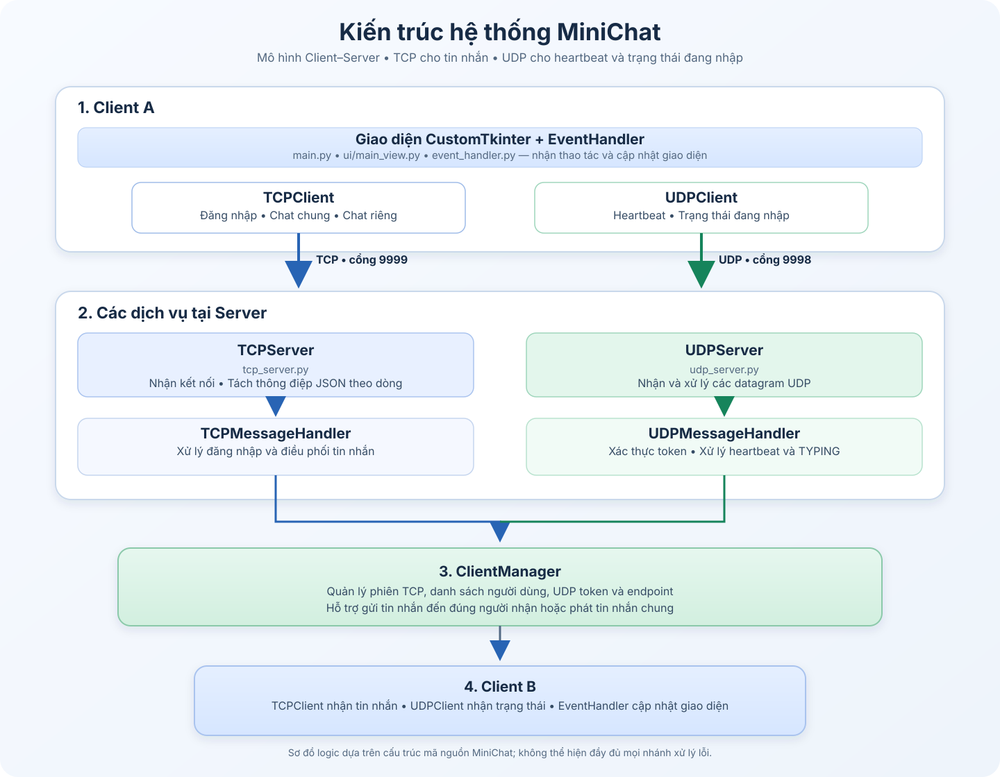
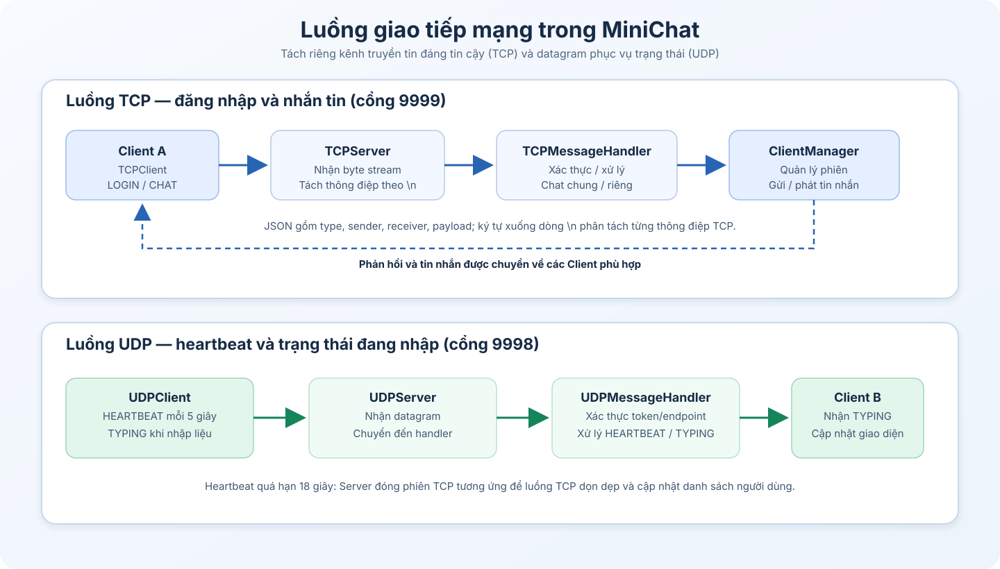

# MiniChat — Ứng dụng nhắn tin Client–Server

-3776AB?logo=python&logoColor=white)


**MiniChat** là ứng dụng nhắn tin nhiều người dùng được xây dựng bằng Python theo mô hình **Client–Server**, thực hiện trong khuôn khổ môn **IT005 — Mạng máy tính**. Dự án tập trung vận dụng lập trình socket, giao thức TCP/UDP, trao đổi dữ liệu JSON và xử lý đa luồng trong một ứng dụng có giao diện đồ họa.

Ứng dụng cho phép người dùng đăng nhập bằng tên hiển thị, trao đổi tin nhắn trong chat chung hoặc chat riêng, theo dõi trạng thái người dùng và nhận thông báo khi người khác đang nhập tin nhắn.

## Nội dung

- [Tính năng](#tính-năng)
- [Kiến trúc hệ thống](#kiến-trúc-hệ-thống)
- [Công nghệ sử dụng](#công-nghệ-sử-dụng)
- [Cấu trúc dự án](#cấu-trúc-dự-án)
- [Cài đặt và chạy trên Windows](#cài-đặt-và-chạy-trên-windows)
- [Chạy qua mạng LAN](#chạy-qua-mạng-lan)
- [Chạy kiểm thử](#chạy-kiểm-thử)
- [Giới hạn hiện tại](#giới-hạn-hiện-tại)

## Tính năng

- **Đăng nhập:** Người dùng tham gia bằng tên hiển thị; tên đang được sử dụng sẽ bị từ chối.
- **Chat chung:** Server phát tin nhắn đến các Client đang trực tuyến. Lịch sử chat chung trong bộ nhớ được gửi cho người đăng nhập sau.
- **Chat riêng:** Chuyển tin nhắn đến người nhận được chọn, không phát nội dung riêng tư đến các Client khác.
- **Trạng thái người dùng:** Hiển thị người dùng đã biết và phân biệt trạng thái trực tuyến/ngoại tuyến trong phiên Server hiện tại.
- **Trạng thái đang nhập:** Thông báo hoạt động nhập liệu qua UDP.
- **Xử lý nhiều Client:** Server dùng đa luồng để phục vụ các kết nối TCP đồng thời.

## Kiến trúc hệ thống

Sơ đồ dưới đây thể hiện các thành phần chính và cách Client, Server cùng sử dụng TCP/UDP. `ClientManager` là thành phần dùng chung để quản lý phiên kết nối, danh sách người dùng và thông tin endpoint UDP.



### Luồng giao tiếp TCP và UDP

- **TCP — cổng 9999:** Dùng cho đăng nhập, danh sách người dùng, chat chung, chat riêng và thông báo hệ thống. Thông điệp được mã hóa JSON và phân tách bằng ký tự xuống dòng `\n`.
- **UDP — cổng 9998:** Dùng cho heartbeat định kỳ và trạng thái đang nhập. Server xác thực token và endpoint UDP trước khi xử lý trạng thái.



## Công nghệ sử dụng

| Thành phần | Công nghệ |
|---|---|
| Ngôn ngữ | Python 3.12 |
| Giao diện | CustomTkinter |
| Giao tiếp tin nhắn | TCP Socket |
| Heartbeat và trạng thái đang nhập | UDP Socket |
| Định dạng thông điệp | JSON |
| Xử lý đồng thời | `threading`, `queue` |
| Kiểm thử | `unittest` |

## Cấu trúc dự án

```text
MiniChat/
├── common/
│   ├── __init__.py
│   ├── constants.py
│   └── protocol.py
├── server/
│   ├── __init__.py
│   ├── main.py
│   ├── tcp_server.py
│   ├── tcp_message_handler.py
│   ├── udp_server.py
│   ├── udp_message_handler.py
│   └── client_manager.py
├── client/
│   ├── __init__.py
│   ├── main.py
│   ├── tcp_client.py
│   ├── udp_client.py
│   ├── event_handler.py
│   └── ui/
│       ├── __init__.py
│       ├── login_view.py
│       └── main_view.py
├── tests/
│   ├── test_tcp_message_handler.py
│   └── test_udp_message_handler.py
├── docs/
│   └── images/
│       ├── minichat-architecture.svg
│       └── minichat-network-flow.svg
├── requirements.txt
└── README.md
```

## Cài đặt và chạy trên Windows

### 1. Chuẩn bị môi trường

Cài đặt Python 3.12, tải hoặc clone repository, rồi mở Terminal/PowerShell **tại thư mục gốc `MiniChat`** — thư mục chứa `common`, `client` và `server`.

Kiểm tra Python:

```powershell
python --version
```

### 2. Cài đặt thư viện

```powershell
python -m pip install -r requirements.txt
```

### 3. Khởi động Server

Mở Terminal thứ nhất tại thư mục gốc:

```powershell
python -m server.main
```

Giữ Terminal này mở trong suốt quá trình sử dụng. Theo cấu hình mặc định, Server lắng nghe TCP tại cổng `9999` và UDP tại cổng `9998`.

### 4. Khởi động Client

Mở Terminal thứ hai tại **cùng thư mục gốc**:

```powershell
python -m client.main
```

Nhập tên người dùng trên cửa sổ đăng nhập. Muốn thử nhiều người dùng, mở thêm Terminal và chạy lại lệnh Client; mỗi cửa sổ sử dụng một tên khác nhau.

### 5. Kết thúc chương trình

Đăng xuất hoặc đóng các cửa sổ Client. Để dừng Server, quay lại Terminal Server và nhấn `Ctrl + C`.

## Chạy qua mạng LAN

1. Khởi động Server trên máy chủ và xác định địa chỉ IPv4 nội bộ của máy đó.
2. Trên từng máy Client, mở `common/constants.py` và đổi `SERVER_IP` từ `127.0.0.1` thành địa chỉ IPv4 của máy Server, ví dụ `192.168.1.10`.
3. Nếu kết nối bị Windows Firewall chặn, cho phép Python hoặc mở quyền giao tiếp phù hợp cho TCP cổng `9999` và UDP cổng `9998` trên máy Server.
4. Chạy Client theo hướng dẫn ở trên.

Chỉ nên thử trong máy cá nhân hoặc mạng LAN tin cậy. Không mở các cổng này trực tiếp ra Internet công cộng.

## Chạy kiểm thử

Tại thư mục gốc của dự án, chạy:

```powershell
python -m unittest discover -s tests -v
```

Các bài kiểm thử hiện có tập trung vào xử lý thông điệp TCP và UDP, gồm phát tin nhắn chat chung, chuyển tin nhắn riêng, lịch sử chat chung, đăng ký heartbeat, xác thực endpoint và chuyển tiếp trạng thái đang nhập.

## Giới hạn hiện tại

- Đăng nhập dùng tên hiển thị, chưa có tài khoản/mật khẩu hoặc cơ chế lưu tài khoản.
- Lịch sử chat chung được giữ trong RAM, tối đa 500 tin nhắn; lịch sử sẽ mất khi Server khởi động lại.
- Lịch sử chat riêng chỉ được lưu trong bộ nhớ của cửa sổ Client hiện tại, không phải lịch sử riêng bền vững trên Server.
- UDP không bảo đảm chuyển phát datagram; trạng thái đang nhập có thể bị bỏ lỡ khi mạng không ổn định.
- Chưa có mã hóa TLS hoặc tính năng gửi tệp.
- Dự án hướng đến mục đích học tập và demo mạng máy tính, chưa được thiết kế để triển khai như một dịch vụ nhắn tin công khai.
